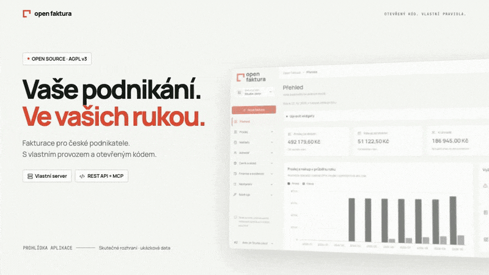

# Open Faktura

Fakturační aplikace pro živnostníky a firmy, kterou můžete provozovat na vlastním serveru. Jeden účet, více fakturačních profilů, české i anglické rozhraní a společný základ pro web a desktop.

**Projekt je ve vývoji; implementace už zahrnuje prodej, nákup, banku, pokladnu, prodejky, inbox, sklad a přehledy.** Probíhá doplňování a ověřování zbývajícího rozsahu P16–P20 a příprava veřejné distribuce. Veřejná beta ani samostatný osobní desktop zatím nejsou dokončené. Projekt je plně open source pod [GNU AGPL v3](LICENSE).



[Přehrát celé promo video (76 s)](docs/media/open-faktura-promo.mp4) · Skutečné záběry aplikace se syntetickými ukázkovými daty.

[Dokumentace](docs/README.md) · [Přehled funkcí](FEATURES.md) · [Checklist funkcí](docs/FEATURE_CHECKLIST.md) · [Instalace](docs/INSTALLATION.md) · [Lokální vývoj](docs/DEVELOPMENT.md) · [Implementační plán](docs/IMPLEMENTATION_PLAN.md)

## Aktuální fáze

Stav dokumentace zkontrolován 23. 10. 2026 proti implementaci v repozitáři. Funkční rozsah přesahuje první fakturační pilot (milník B) a zahrnuje velkou část modulů milníků D/E. Podmínky veřejné self-hosted bety (milník C) však nejsou všechny splněné; dokončení modulů a připravenost vydání sledujeme odděleně.

[Checklist funkcí](docs/FEATURE_CHECKLIST.md) eviduje implementovaný i zbývající rozsah; [stav P16–P20](docs/P16_P20_COMPLETION.md) shrnuje návaznosti. [Implementační plán](docs/IMPLEMENTATION_PLAN.md) zachovává také historické záznamy dodávek. Implementace sama neznamená úplnou shodu s iDokladem ani provozní ověření na všech platformách.

## Co už můžete používat

- Založení správce, přihlášení, nastavení účtu a více oddělených fakturačních profilů.
- Adresář odběratelů s doplněním údajů z ARES a [anonymizací adresáře](docs/specs/contact-anonymization.md) při zachování historických dokladů.
- Návrh faktury → vystavení a číslování → PDF s QR platbou → e-mail → ruční úhrada.
- Splatnost faktury ihned, výběrem 7, 14, 21, 30 nebo 60 dní od vystavení, případně vlastním datem.
- Výchozí splatnost v nastavení firmy, automaticky předvyplněná na nové faktuře.
- Ceník, opakovaně použitelné šablony a cenové nabídky s převodem na fakturu.
- Veřejné odkazy na nabídky i faktury, odvolání odkazu a historie zobrazení.
- Bankovní účty s českým i zahraničním IBAN v CZK i cizích měnách, počáteční salda, [import výpisů](docs/specs/bank-statements.md), ruční, dělené a dávkové párování úhrad.
- [Bankovní napojení](docs/specs/bank-connections.md) přes Fio nebo vlastní gateway, ruční i plánovaná synchronizace, notifikační brána a samostatně zapínané automatické párování. Živé ověření bank zůstává otevřené.
- [Pokladna](docs/specs/cash-register.md): příjmy/výdaje, saldo, volitelné automatické doklady, samostatná plnění s DPH a PDF s částkou slovy CS/EN.
- [Cizoměnové doklady a přehledy](docs/specs/report-currencies.md), uložené kurzy a návrh kurzu ČNB na vyžádání.
- [Párování rozdílných měn](docs/specs/bank-foreign-matching.md) u faktur, záloh a vratek dobropisů a přehled uložených kurzových rozdílů bez účetního zaúčtování.
- [Evidence DPH a orientační obrat](docs/specs/tax-dashboard.md) včetně samostatných pokladních plnění; nejde o daňové přiznání ani zákonný obrat.
- Přijaté faktury a účtenky, originální přílohy, výdajové úhrady a přehled nákladů.
- Zálohové faktury, daňové doklady k přijaté platbě a vyúčtování plně uhrazených záloh; dobropisy se zápočty a vratkami.
- Pravidelné faktury s volitelným vystavením a odesláním, upomínky a poděkování; automatizace se zapíná výslovně.
- Vlastní SMTP, testovací odeslání, historie e-mailů a souborové přílohy.
- Export seznamu faktur a odběratelů do CSV/XLSX s filtry a výběrem sloupců.
- Obecný import kontaktů a ceníku CSV/XLSX s mapováním a kontrolou před zápisem.
- [Import ceníku Money S3 XML](docs/specs/catalog-import.md): základní CZK ceny, náhled, konflikty a ochrana proti duplicitám.
- Prodejky v CZK s kombinovanými úhradami a dávkovým zaúčtováním.
- [Inbox originálů](docs/specs/inbox.md), bezpečný náhled, kontrolovaný návrh ISDOC/QR, práce s dodavatelem a volitelný příjem přes vlastní bránu nebo IMAP i vytěžování přes nakonfigurovaného poskytovatele, oznámení, odpojení originálu a [předání účetnímu](docs/specs/inbox-delivery.md).
- Správa členů a vlastnictví profilů, přenosný archiv, štítky s filtry a koš nevystavených nepropojených návrhů a nepoužitých nabídek/šablon.
- Logo/podpis na nových PDF, hromadný tisk, dodací list s volbou cen, potvrzení úhrady a exportní snapshoty se zámkem obsahu.
- Export běžných faktur do ISDOC 6.0.2, ruční kontrola DIČ přes RWS/VIES a [vlastní importní adaptéry](docs/INTEGRATION_ADAPTERS.md).
- Přehled prodeje po ceníkových položkách s filtry období/typu, skutečnými částkami, zdrojovými doklady a exportem CSV/XLSX.
- Skladové pohyby z faktur, nákupů a prodejek včetně oprav a vratek; ruční pohyby, inventury, souhrnný stav k datu a ruční ocenění i automatický průměr nákupních příjmů, ocenění vratek a rozvržení cenových oprav i vedlejších nákladů. Pořizovací ceny lze zadat také u počátečních stavů, ručních příjmů a inventurních přebytků.
- Měsíční, kvartální, roční i kumulativní přehled prodeje/nákupu, meziroční srovnání a zdrojové doklady.
- Bilance prodeje/nákupu, TOP 3 odběratelé a dlužníci a přehled prodlení v CZK.
- Čeština a angličtina, světlý/tmavý/systémový vzhled, REST API a lokální MCP.
- Vlastní vizuální identita Open Faktury, nové logo, Přehled a seznam/editor faktur — [UI-REDESIGN-01](docs/design/redesign-2026-10-17/README.md).

Aplikace podporuje CZK i vybrané cizoměnové postupy; konkrétní omezení uvádí [checklist funkcí](docs/FEATURE_CHECKLIST.md). Výpočty mají dokumentovaná vlastní pravidla; numerická shoda s externími systémy není kompletně ověřená. Importní předvolby **pro konkrétní služby nejsou ověřené adaptéry**. CSV/XLSX export je tabulkový přehled, ne úplná záloha ani účetní export.

## Co zbývá

- Pravidelné zálohy, rozšíření nákupního editoru a výstupů, další hromadné operace a tiskové preference.
- Úplné daňové režimy, přiznání DPH/KH/SH a různé daňové kurzy DDPP při vyúčtování plátce. Evidence DPH a uživatelská klasifikace podkladů jsou dostupné, podání nenahrazují.
- Ověření bankovních adaptérů na skutečných anonymizovaných exportech, další nativní integrace a terminálový hardware. Podpora vlastní gateway neznamená nativní napojení všech bank.
- E-mailové pozvánky, dvoufázové ověření, vzdálené MCP s OAuth, úplný audit přístupnosti a provozní, bezpečnostní a zátěžové ověření veřejné bety.
- Produkční podpisy/notarizace, skutečné instalační a aktualizační zkoušky cílových OS a osobní desktop s přibaleným backendem a PostgreSQL.

Podrobné hranice včetně měnových omezení uvádí [checklist](docs/FEATURE_CHECKLIST.md). Neověřené externí formáty lze řešit [vlastním adaptérem](docs/INTEGRATION_ADAPTERS.md); tím se nedeklaruje jejich nativní kompatibilita.

## Spuštění pro vývoj

Potřebujete Node.js 22.22.0 nebo kompatibilní novější verzi, pnpm 10.29.3, Rust přes rustup a Docker Compose. Verzi Rustu určuje [rust-toolchain.toml](rust-toolchain.toml).

```sh
git clone git@github.com:janMoudry/open-faktura.git
cd open-faktura
pnpm install --frozen-lockfile
# Pouze při první instalaci; existující .env nepřepisujte.
cp .env.example .env
node scripts/init-secrets.mjs
pnpm db:up
pnpm dev
```

Web: [127.0.0.1:5173](http://127.0.0.1:5173). API: [127.0.0.1:3001/api/ready](http://127.0.0.1:3001/api/ready). Při prvním otevření založíte správce pomocí lokálního instalačního klíče podle [instalačního návodu](docs/INSTALLATION.md). Server aplikuje databázové migrace při startu.

Pro nasazení na vlastní server použijte [produkční instalační postup](docs/INSTALLATION.md), nikoli vývojové přihlašovací údaje.

### Desktop a mobil

Tauri sdílí webové rozhraní a připojuje se k běžícímu Rust API. Vývojový desktop spustíte přes `pnpm dev:desktop` se samostatně běžícími DB a API; nespouštějte zároveň druhý Vite server. [Podrobnosti a nativní závislosti](docs/DEVELOPMENT.md#desktop).

[Build matice instalátorů](docs/DESKTOP_RELEASES.md) připravuje draft GitHub Releases; lokálně je ověřené sestavení macOS DMG. [Ručně potvrzený signed updater](docs/specs/desktop-updates.md) je implementovaný jako build-time opt-in s vlastním endpointem/veřejným klíčem, výchozí vypnutý. Produkční platformní podpisy/notarizace, skutečný upgrade instalace na všech OS a osobní režim s přibaleným backendem/PostgreSQL zatím nejsou ověřené nebo dokončené. Na mobilu je dostupný responzivní online web s PWA manifestem, ikonami a instalací přes podporovaný prohlížeč. Při výpadku navigace zobrazí obecnou CS/EN obrazovku; účetní data neukládá offline a offline fakturaci nepodporuje. Instalace na fyzických mobilních zařízeních a do OS zatím není ověřená; podrobnosti a stav ověření uvádí [specifikace PWA](docs/specs/pwa.md).

## Technologie a struktura

| Vrstva        | Technologie / umístění                                        |
| ------------- | ------------------------------------------------------------- |
| Web           | React, TypeScript, Tailwind — `apps/web`                      |
| Desktop       | Tauri — `apps/desktop`                                        |
| Design systém | Komponenty a tokeny — `packages/ui`, `packages/design-tokens` |
| API klient    | Typované kontrakty — `packages/api-client`, `contracts`       |
| Backend       | Rust, Axum, SQLx — `crates`                                   |
| Databáze      | PostgreSQL — `migrations`                                     |
| Provoz        | Docker Compose, zálohy — `infra`, `scripts`                   |

Web, REST a MCP používají společná pravidla a profilová oprávnění. [Architektura a konvence](docs/architecture/DEVELOPMENT_CONVENTIONS.md) · [Datový model](docs/DATA_MODEL.md)

## Vývoj a ověření

```sh
pnpm check          # lokalizace, typy, formát, konvence a Clippy
pnpm test           # Rust testy; DB scénáře jsou samostatné
pnpm build:web      # produkční web
pnpm generate:api   # regenerování API klientů a MCP schémat
```

Integrační testy potřebují PostgreSQL s právem vytvářet izolované databáze. Příkazy jednotlivých modulů a E2E scénáře jsou v [AGENTS.md](AGENTS.md) a [návodu pro vývoj](docs/DEVELOPMENT.md). Testovací e-maily používají pouze lokální SMTP capture.

Katalog komponent zůstává vývojovým nástrojem na `/sandbox.html#/design-system`; není součástí produkčního vstupu. Tajné údaje, lokální data a screenshoty z průzkumu se necommitují.

## Rozsah a přispívání

- [Checklist: co funguje a co zbývá](docs/FEATURE_CHECKLIST.md)
- [Plán dodávek P00–P20](docs/IMPLEMENTATION_PLAN.md)
- [Dostupné funkce, omezení a plánované rozšíření](FEATURES.md)
- [Pravidla práce a lokální agentní skills](AGENTS.md)
- [Evidence průzkumu a hranice shody](docs/research/EVIDENCE.md)
- [Lokalizace CS/EN](docs/LOCALIZATION.md)

Při změnách doplňte odpovídající specifikaci, testy, oba jazyky a stav checklistu. Doložené chování reference odlišujeme od vlastních návrhů; zelený technický test sám nepotvrzuje funkční shodu.

## Licence

Open Faktura je svobodný a open-source software pod **GNU Affero General Public License, verze 3** (`AGPL-3.0-only`). Můžete ji používat, upravovat, sdílet i prodávat při dodržení licence. Při distribuci platí povinnosti zpřístupnění odpovídajícího zdrojového kódu; u upravené verze provozované přes síť musí její uživatelé dostat nabídku tohoto kódu.

Copyright (C) 2026 přispěvatelé Open Faktury. Software je poskytován bez záruky v rozsahu dovoleném právem. Úplné znění je v [LICENSE](LICENSE), praktické vysvětlení v [licencování](docs/LICENSING.md).

Licence použitých fontů a knihoven zůstávají zachované u příslušných součástí. Referenční zdroje a původ požadavků jsou dohledatelné ve [výzkumné dokumentaci](docs/README.md#výzkumné-podklady).
